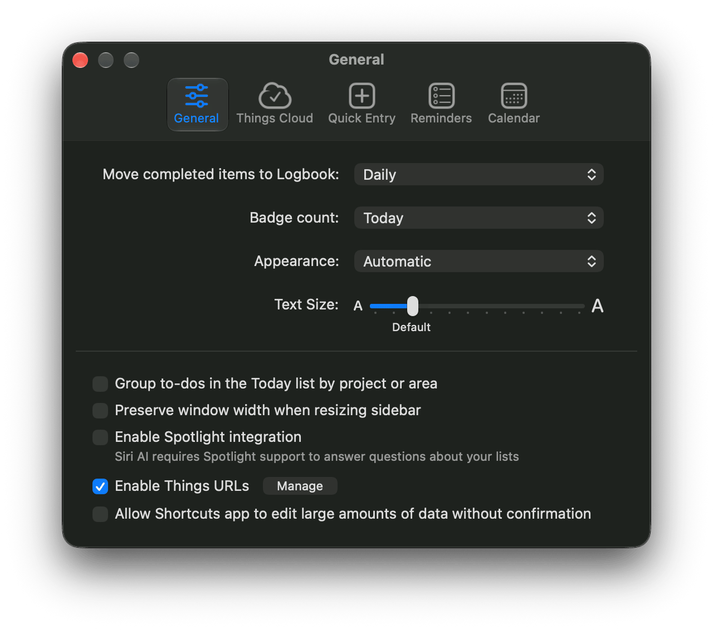
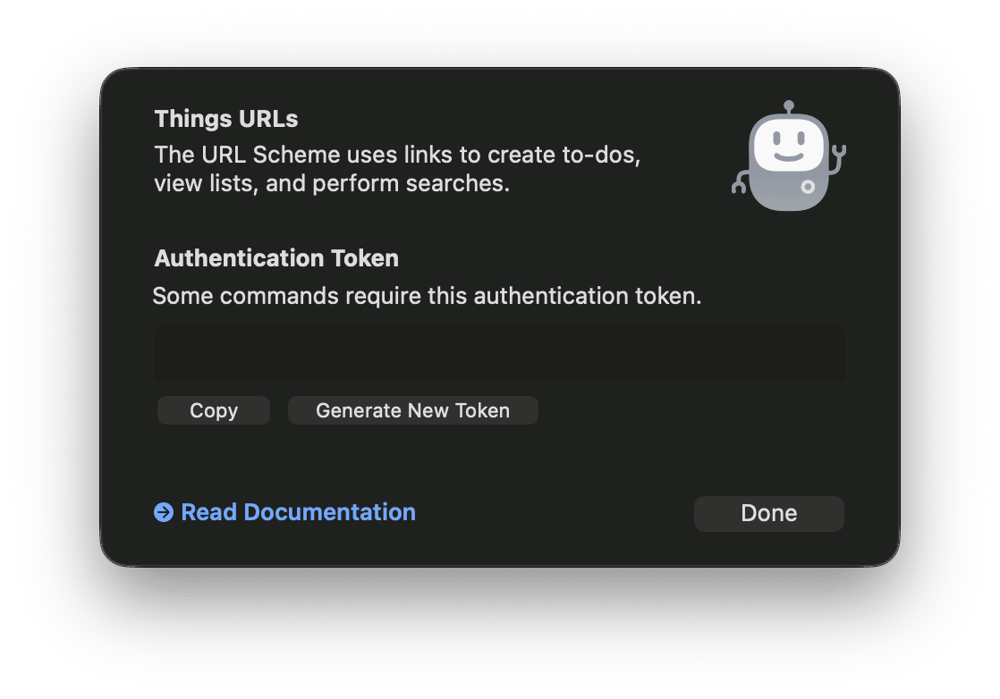

# things

A CLI and stdio MCP server for [Things 3](https://culturedcode.com/things/).
Reads use the local SQLite database; writes use the Things URL scheme.
Writes are journaled and verified by reading the database.
Opening a URL does not prove success.


## Install

The executable requires macOS 12 or later and Things 3.
Install it with [Homebrew](https://brew.sh):

```sh
brew install mattt/tap/things
things version
things doctor
```

Or build with Go (`go.mod` specifies toolchain Go 1.26.2):

```sh
make
make install PREFIX="$HOME/.local"
```

Database versions 22 through 29 are supported.
Unsupported versions or missing required fields cause capability errors.
Use `--database /path/to/main.sqlite` to select a library for reads.
Set `THINGS_DATABASE` to the same path when you cannot change the arguments,
such as in an MCP client configuration; the flag takes precedence.
Writes require the single automatically discovered library;
other files support reads and dry runs only.
Multiple discovered libraries block writes.
Reconciliation requires the recorded database file identity;
records without one cannot be reconciled against a Things database.

Allow each launching app access to "Data shared by Things and affiliated apps"
in System Settings > Privacy & Security > Files & Folders,
or grant it Full Disk Access.
Claude Desktop does not pass its permissions to MCP servers;
run the server from an app with access instead.
Do not use elevated privileges.

## Authentication

In Things, choose Things > Settings, then General.
Select Enable Things URLs, then click Manage.



Click Copy to copy the authentication token.



Store the token in macOS Keychain; the prompt hides input:

```sh
things auth set
things auth status
things auth delete
```

Automation can use `things auth set --stdin` or `THINGS_AUTH_TOKEN`,
which overrides Keychain.
Tokens stay out of output, journals, and process arguments.
Only updates require a token.

## Read commands

```sh
things list today
things search "meeting" --project PROJECT_ID
things get TASK_ID
things projects
things areas
things tags
things open TASK_ID
```

Other lists are inbox, evening, upcoming, anytime, someday, logbook, and trash.
List and search filters include `--project`, `--area`, `--tag`, and `--status`.
Selectors accept IDs or unique ID prefixes; tasks also accept Things links,
and containers accept exact unique names.
Ambiguous selectors fail.

Pages default to 50 records.
Use `--limit` (1 through 500), `--cursor` for another page,
or `--all` for exports.
Cursors require the same query and unchanged matching records;
start a new query after a stale-cursor error.
Upcoming excludes future recurring occurrences that are not yet stored.
Reads do not establish that Things Cloud has finished syncing.

## Create and update

Use `--dry-run` to validate without dispatch.

```sh
things add "Review landing page" --project PROJECT_ID --when tomorrow
things update TASK_ID --deadline 2026-10-16 --add-tag work
things update TASK_ID --clear-deadline
things complete TASK_ID --operation-key review-landing-page-done
things cancel TASK_ID
things reopen TASK_ID
things project add "Website refresh" --file examples/project.json --dry-run
things project update PROJECT_ID --notes "Updated project notes."
```

`--when` accepts ISO dates, today, tomorrow, evening, and someday;
creation also accepts anytime.
Use `--clear-when` to clear scheduling on updates.
Other date expressions are unsupported.
`--reminder HH:MM` requires a scheduled day or evening.
Dates and times are local.
For reminder changes on an Evening task dated outside today,
change its schedule explicitly or edit the reminder in Things.
If midnight passes before Evening dispatch, the write fails without dispatch.

`--tag` replaces tags; `--add-tag` adds them.
Tags must exist with unique titles, even when selected by ID.
Use `--clear-notes`, `--clear-deadline`, `--clear-reminder`, `--clear-tags`,
or `--clear-checklist` to clear fields.
Clearing destinations is unsupported.

JSON input uses `patch` and optional project `items`.
Omitted fields are preserved; `null` clears supported fields.
Unknown fields are rejected.
Limits are 10,000 characters for notes, 4,000 for titles,
combined tag titles, or checklist text, and 100 checklist rows.
The journal limits creation to 250 items per 10 seconds.

New project items can be `todo` or `heading`;
headings apply to following tasks.
Creating or editing headings in existing projects, creating areas or tags,
and changing recurrence rules are unsupported.
Recurring templates reject schedule, deadline, status, and reminder changes.
Projects with incomplete children or active headings cannot be closed.

## Operation outcomes

```sh
things operations get OPERATION_ID --json
things operations reconcile OPERATION_ID --json
things operations prune
```

Records include IDs, evidence, and an outcome:

| Outcome | Meaning |
| --- | --- |
| `confirmed` | A fresh read matched the requested fields. |
| `failed` | Preflight or an explicit rejection established failure. |
| `unknown` | Dispatch or verification could not establish the result. |
| `partial` | A batch has different results among its actions. |

Verification defaults to 10 seconds; `--verify-timeout` allows up to 5 minutes.
Timeouts return `unknown` and a nonzero exit code.
Reconciliation reads current state without resending writes.
Creation requires one newly visible candidate matching the payload;
an existing matching title is insufficient.

Reusing `--operation-key` with the same request returns the saved result
or reconciles uncertainty; a different request is rejected.
Uncertain operations are never automatically dispatched again.
This does not guarantee exactly-once delivery.
`--expected-fingerprint` rejects changes since a read.
The service rechecks before dispatch, but concurrent edits can still race.

The private journal and lock reside in
`~/Library/Application Support/things-cli/`; `--config-dir` isolates them.
Pruning removes settled records older than 90 days and their replay protection.
Uncertain records and children needed by unsettled batches remain.

## Batches

```sh
things batch --file examples/batch.json --dry-run --json
things batch --file plan.json --operation-key weekly-review --json
```

The [schema](schema/batch.schema.json) defines batch actions.
All actions and existing references are validated before dispatch.
Each item permits one update per batch.
Actions run sequentially and stop at the first unconfirmed result;
remaining actions are recorded as not dispatched.
Batches can partially complete and do not roll back.

## JSON and exit codes

`--json` returns structured output, including uncertain operation records.
JSON preserves imported text; human output removes terminal control sequences.
Diagnostics go to stderr.
Errors have stable `code` values.

| Exit | Meaning |
| --- | --- |
| 0 | Successful read, validated dry-run, or confirmed mutation |
| 1 | Unexpected internal error |
| 2 | Invalid input |
| 3 | Missing or ambiguous item |
| 4 | Configuration or permission failure |
| 5 | Unsupported capability |
| 6 | Rejected write |
| 7 | Uncertain outcome |
| 8 | Partial batch |

## MCP

```sh
things mcp
things mcp config --read-only
```

`mcp config` prints client configuration with the executable's absolute path.
It does not modify clients.
Omit `--read-only` to enable writes.
Read-only mode omits mutation tools and blocks reconciliation.
Server stdout carries only protocol messages.
Write tools accept operation keys and dry runs.
Failed, uncertain, and partial writes set `isError` and retain operation data.
Treat task content as untrusted data.

## Optional callback app

```sh
make helper
open "dist/Things CLI Callback.app"
things --callbacks doctor
```

Enable it with `--callbacks`; database verification remains required.
Project callbacks return only the project ID; nested IDs require observation.
Builds use ad hoc signing by default.

## Development

```sh
make setup
make fmt
make lint test
make fuzz
make benchmark
make generate
```

Setup downloads modules and installs clang-format with Homebrew.
Tests use synthetic databases and mock dispatchers with the race detector.
`make generate` updates the batch schema; tests detect a stale schema.

## Acknowledgments

Schema relationships, date and reminder decoding, and list membership rules
are adapted from [things.py](https://github.com/thingsapi/things.py),
by its authors and contributors, under the Apache License 2.0.

## License

This project is available under the MIT license.
See the LICENSE file for more info.
